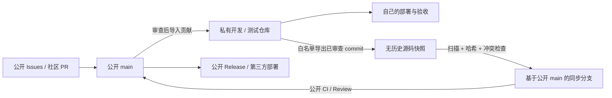

# 开源准备、双仓库同步与改名迁移

> 日期：2026-09-30 ｜ 状态：历史方案。当前 README、CI 和贡献流程由仓库根目录直接维护。本记录中的双仓导出命令仅适用于旧版本。

## 1. 背景与现状

目标是保留当前仓库作为私有开发、部署和真实环境测试来源；新公开仓库负责源码、第三方自托管、Issues、社区 PR 和 Releases。公开源码必须排除实例凭据、运行数据、私人身份映射与内部工作记录。

审阅基线是 `main` 的 `fa2462f`，产品版本为 `0.17.0`。启动时没有已跟踪文件改动，但有未跟踪的 `.claude/`、`HANDOFF.md`、`packages/bot/src/skills/$OUT/`。这些内容保留在原处，不参与导出。本任务不恢复已暂停的 UI goal，也不读取其授权。

| 现状证据                                                                              | 对开源的影响                                                     | 本轮处理                                                  |
| ------------------------------------------------------------------------------------- | ---------------------------------------------------------------- | --------------------------------------------------------- |
| `LICENSE:1` 已有 MIT                                                                  | 根包的 `private: true` 只是阻止 npm 发布，与 GitHub 是否公开无关 | 保留现有 MIT 许可文本                                     |
| `package.json:5` 原描述还称 Vue                                                       | 会误导贡献者                                                     | 更新为自托管 AI 伴侣定位                                  |
| `packages/shared/src/lark.ts:56` 原有 27 位用户的 GitHub → 飞书 open ID 默认表        | 联系人身份映射不应随源码分发                                     | 移除默认表；保留类型和已有 Bot 显式配置                   |
| `docker-compose.yml:12`、`scripts/check-dokploy-compose.mjs:60` 含现有 Dokploy 网络名 | 第三方不能直接复用，也暴露实例标识                               | 公开快照替换为通用 `app-proxy`；现有私有部署配置继续兼容  |
| `scripts/dev-mini-app.sh:6` 含个人测试域名                                            | 第三方不能使用现成隧道                                           | 公开快照要求自己设置 HTTPS origin                         |
| `.github/workflows/ci.yml:13` 绑定维护者 Mac                                          | 外部 PR 不应进入这台机器                                         | 导出时替换为 GitHub 托管 Ubuntu CI                        |
| `scripts/update-production.sh:5` 固定旧 Compose 名，原来仅跟随 `origin/main`          | 第三方难以固定 release；改目录可能误建 volume                    | 增加指定 tag、远程、项目名、备份目录；保持原默认值        |
| `packages/server/src/auth.ts:17` 使用固定 organization slug                           | 全文替换产品名可能生成第二个工作区                               | 与对外品牌分开，保留旧 slug                               |
| `packages/server/src/env.ts:18`、`env.test.ts:36` 明确保留历史加密默认值              | 直接删默认值会破坏旧密文                                         | 不改历史解密契约；新部署工具生成独立随机 key              |
| `docs/releases/` 是公共 changelog 的构建来源                                          | 删掉整个内部 docs 目录会丢失版本页面                             | 仅导出 releases，去掉指向私有仓库的链接，保留发布行为正文 |

初步扫描当前 1,188 个跟踪文件：未找到与本地 `.env` 中长度至少 12 的非占位秘密值相同的文本；常见私钥、GitHub/AWS/API token 模式没有匹配，两个 Telegram token 匹配属于已核实的合成测试数据。个人部署信息主要分布在内部文档、默认配置和测试样例。这个检查没有证明整个历史或任意形式的秘密不存在，不能据此直接把旧仓库改公开。

## 2. Goals / Non-Goals

**Goals**：得到可审阅、可重复导出的公开源码树；第三方可以生成独立配置；公开与私有仓库保持同一套业务实现；指定 release 升级前完成备份，升级后通过 readiness；改名时保护原有数据和权限。

**Non-Goals**：不改许可、不创建远程仓库、不提交/推送/提 PR/发布/部署、不迁移生产数据、不改数据库名或认证组织、不重写历史迁移、不导出旧 Git 历史、不替第三方创建 Telegram、Google 或 GitHub 凭据。

## 3. 约束与假设

- 公开仓库独立初始化，不属于私有仓库的 fork 网络。私有历史不进入公开 refs。
- 两边产品版本统一由根 `package.json` 决定；各自构建时健康接口仍使用各自完整 commit SHA。
- 现有实例保持 Compose 项目名、volume、数据库名、组织 slug、加密 key 与迁移 journal。
- 默认公开全部应用模块，包括可选 worker 与 Dev Harness 源码；是否首发隐藏实验入口留待 owner 决定。
- 模板、源码、公共文档与发行说明属于产品；机器配置、联系人、运行数据和内部工作记录属于实例。

## 4. 推荐方案：受控源码快照 + 公开分支 PR



不能把私有分支直接推到公开 remote 再提 PR：分支携带全部祖先提交，文件删除不删除历史。公开分支必须从公开 main 创建，只带经过审阅的源码变化。仓库间没有共同祖先时，不用 merge 强接历史。

### 导出与审阅

```bash
# 本轮未提交改动的本地审阅；输出目录必须不存在
pnpm public:export --worktree --out .open-source/review-next
pnpm public:check --dir .open-source/review-next

# 后续取得提交授权并完成私有候选 commit 后，用实际候选 SHA 替换
pnpm public:export --ref <PRIVATE_CANDIDATE_SHA> --out /tmp/public-candidate
pnpm public:check --dir /tmp/public-candidate
```

`export-public.mjs` 默认读取指定 Git commit 的 blobs，不把未提交文件带进发布。`--worktree` 只读取已跟踪工作文件与显式列出的新发布资产，不遍历未知的未跟踪内容，manifest 标记为 `reviewOnly`，同步工具拒绝使用它。

`scripts/lib/public-export.mjs` 以白名单保留七个包的源文件、配置、数据库完整迁移和 metadata、公开 docs、acceptance、基础设施与运行脚本。内部 `docs/` 仅保留版本记录；排除 `.git`、`.env`、运行目录、内部任务、机器配置、自动生成 changelog 和个人 `$OUT` 内容。符号链接与 submodule 在导出时拒绝。

公开 README、AGENTS、贡献指南、Security 与 CI 由 `open-source/` 中的专门模板覆盖。只对已核实的默认部署标识、测试样例用户名、私有版本链接做确定性转换，转换后的内容再次扫描；没有自动替换未知 secret 的“尽力发布”模式。扫描失败只打印路径、行号、规则，不打印匹配值。

`.public-manifest.json` 记录产品版本与每个文件的 SHA-256，不记录私有 commit、作者邮箱、时间、机器路径或 Git remote。每次导出必须使用新目录；现有目录不覆盖。`public:check` 校验所有文件、额外路径、符号链接和缺失文件。哈希只证明与该 manifest 一致，不是安全签名。

初次公开仓库应在已确认的路径中复制审查后的正式快照，再独立初始化 Git；发布前启用分支保护、私密漏洞报告和 secret scanning。不得复制 `.git` 或 mirror 私有 refs。上述外部操作仍需明确授权。

### 日常向公开仓库同步

在独立公开 checkout 中先从最新公开 main 建立功能分支，确保工作区干净，已有首个公开 manifest，然后从私有仓库运行：

```bash
pnpm public:sync --snapshot /tmp/public-candidate --into <PUBLIC_CHECKOUT>
# 检查计划后，本地应用文件改动；不提交或推送
pnpm public:sync --snapshot /tmp/public-candidate --into <PUBLIC_CHECKOUT> --apply
```

同步只处理 manifest 管理的文件，保留公开仓库独立增加的 issue 模板等内容。它比对上次导出哈希、公开当前文件和本次快照；公开文件相对基线发生了不同的社区修改时直接拒绝覆盖，先把贡献导入私有仓库并重新导出。拒绝当前私有仓库及其共享 Git metadata 的 worktree，也拒绝 main/master、detached HEAD、脏工作区与 review-only 快照。文件修改是可逆的，但中断可能留下部分未提交改动；检查 diff 并处理后再重试，工具不自动 reset。

外部 PR 先在公开仓库审查，然后把相关产品改动导入私有仓库（审查后的 cherry-pick 或 patch；无需共同祖先），完成自己的测试，再发新的同步 PR。源码应保持单一实现，平台和个人差异放在 `.env` 或部署覆盖配置。

### 发布与版本对应

公开发布以公开候选 SHA 为准，发布说明仍来自 `docs/releases/vX.Y.Z.md`。过去的私有版本页面只是历史行为记录，不在新仓库伪造旧 PR、tag 或 release assets。首次公开采用哪个版本是待决问题；不要把有新行为的源码发布成已经发行过的同名不可变版本。

私有部署 SHA 与公开发布 SHA 可以不同。私有 release 记录可以保存两者的对应关系；公共健康接口必须返回实际构建的完整 SHA，不能填私有 SHA 冒充公开构建。公开发行、文档构建、自己的部署是三个独立状态。

## 5. Alternatives

| 方案                                        | 优点                                 | 代价与风险                                                                           | 结论       |
| ------------------------------------------- | ------------------------------------ | ------------------------------------------------------------------------------------ | ---------- |
| 原仓库改公开或 mirror 到新仓库              | 保留完整 blame、提交与标签；操作最少 | 会发布全部旧历史和作者信息，必须完整历史清洗和密钥轮换；违背继续私有的要求           | 不采用     |
| 公开为 upstream，私有 fork 维护少量部署差异 | 社区协作更直接，长期减少导出转换     | 需要改变日常开发方向，首次仍要清洁历史；GitHub fork 网络与独立私有仓库并非任意可互换 | 将来可考虑 |
| 私有主开发，公开受控快照 PR                 | 当前部署流程不变，可明确审阅导出边界 | 公开 blame 不含旧历史，需维护白名单与少量转换；社区变化必须及时回流                  | 当前推荐   |

如果未来绝大多数开发都发生在公开仓库，并且私人差异只剩环境配置，建议改为公开 upstream、私有部署 checkout；届时可以删掉部分导出转换。

## 6. 安全、隐私和维护

- `.env.*` 全部默认忽略，仅 `.env.example` 例外。生产备份、日志、聊天内容、用户映射、截图和来源不明资产不加入导出清单。
- 不对测试文件整体豁免：当前只有具体合成字符串有精确例外，未知 token 仍然阻断。内置规则覆盖常见凭据和已知私人元数据，不能识别所有随机密钥、编码秘密或个人资料。
- 公开 CI 采用 GitHub-hosted Ubuntu、只读 contents 权限、不持久化 checkout 凭据，并配置 Gitleaks 历史扫描。需要在首发前实际运行独立扫描，不把“工具已配置”等同于“已通过”。假阳性必须逐项核实，不能 blanket ignore tests。
- 首发前核查 Logo、字体、图片与内置技能的分发权；MIT 只覆盖有权授权的代码，不替第三方资产和服务授权。
- 新配置独立生成随机密钥，拒绝覆盖 `.env`。不要自动重置已有 `ENCRYPTION_KEY`。旧默认加密 key 的恢复兼容暂时保留，未来强制生产 key 需要单独的重加密迁移方案。
- 外部服务默认按需启用。最小部署要用空 Bot/Provider 数据库验证，避免私有实例中“已经保存的凭据”掩盖新用户的问题。

## 7. 改名与迁移边界

维护者已确认产品名 **Hanori · 花织**，公开仓库名 `hanori`；GitHub owner 仍待确定。私有源码及公开模板统一了 UI、浏览器标题、文档导航、README、package description、OAuth/MCP 显示名与客户端标识。英文界面显示 Hanori，中文显示 Hanori · 花织；历史发行说明保留其当时的名称和行为。不要全文替换 `cos`；它可能是命令、表名、路径与历史兼容字段的一部分。

视觉基调沿用 Koharu 的樱花粉和粉蓝色渐变，采用暖白背景、深莓粉主按钮、圆润卡片，以及原创的樱花与笑脸对话气泡 SVG。登录页、导航与文档共用该标识，系统字体避免新增外部字体下载。桌面登录页包含品牌插画，手机收敛为单栏；文档保留深色主题。后续如增加角色插画，需要可分发的原创资产并保留 SVG 作为加载与小尺寸场景的基础标识。

暂保留 `@cos-tool-bot/*` 内部 workspace scope、`cos_tool_bot` 数据库名、`cos-bot-prod` Compose 默认名、`AUTH_ORGANIZATION_SLUG` 和旧环境变量别名。内部名字不影响新品牌上线；改它们需要专门兼容方案，不能夹在视觉改名中。

当前 Git 仓库继续部署自己的实例，无需切换到公开 Git 历史。若某个用户以后确实跨仓库迁移：新目录取源码、保留稳定配置、验证数据库与全部文件卷备份、停止旧 app、以原项目名启动新 app、验证解密/认证/Bot 投递，再删除旧代码目录。Dokploy 的新应用使用新的命名空间，须按平台备份恢复流程迁移，不能套用仅改目录的方法。

## 8. Rollout / Rollback

1. 完成本轮本地工具、文档与检查；导出 review snapshot。
2. 定产品名、公开 owner/repo、许可和首发版本；实施展示改名与公共入口校对。
3. 对正式候选快照做 Gitleaks、资产检查、冻结锁文件安装与全套构建测试。
4. 用隔离数据库和抛弃式配置完成第一次启动、owner 登录、无 Token 启动、真实测试 Bot、一次前版本升级与恢复演练。Docker 不可用时，这一步明确未完成。
5. 经授权初始化公开仓库，提交 clean initial history，启用独立 CI、分支保护与私密安全报告。
6. 根据公开候选 SHA 经授权发布，检查公开版本文档；自己的部署另行授权和验证。

导出失败不产生公开输出；同步失败不改变提交，若中途文件写入失败留下的 diff 要手工审查。升级备份失败时不改代码和容器；构建失败不写成功 marker。迁移已经执行后不得简单切回旧代码或删 journal，应使用向前修复或在维护窗口恢复对应备份。数据库与文件卷恢复需要保存原密钥。

## 9. Testing / 首发验收

新增行为测试覆盖独立密钥、文件权限、不覆盖环境配置、危险 origin、白名单、未知凭据、symlink、committed blob 与 worktree 隔离、manifest 篡改、同步 dry-run、保留社区变更、tag 升级、备份失败与构建失败。生产脚本以模拟 Docker 测试，不声称等同真实容器验收。

首发还必须验证：干净机器从公开候选安装；最小数据库初始化全部迁移；owner 登录；公开 docs 匿名访问、deep links、搜索、新版本页面；旧实例持有原密钥升级；coding/harness profile 保持隔离；Linux amd64/arm64 目标构建；可恢复的数据库与文件卷备份。只在确实测过时记录成功。

本轮最终检查记录在文末，远程 CI、Linux 首次启动、真实 Telegram 和恢复演练与本地检查分开报告。

## 10. Open Questions

- 公开 GitHub owner 是谁？产品显示名 Hanori · 花织和仓库名 `hanori` 已确认；首版 SVG 标识已实现，可在预览中审阅。
- 目前沿用现有 MIT，保留版权声明；第三方资产仍需单独核查。
- 首次公开的版本号、是否同时提供经过测试的 GHCR 镜像和 release 包？源码方案已准备，镜像发行尚未配置。
- 首发是否突出 Telegram 与管理面板，把 Dev Harness / Pi 标为实验能力？
- 是否提供面向个人服务器的一键运维入口，还是先固定直接 Compose + Dokploy 两条支持路径？本轮不新增自动安装系统组件的脚本。

## 11. References

- [GitHub runner security](https://docs.github.com/en/actions/reference/security/secure-use)：公开 PR 与自托管 runner 的边界。
- [GitHub repository duplication](https://docs.github.com/en/repositories/creating-and-managing-repositories/duplicating-a-repository)：mirror 会复制 refs 与历史，不用于脱敏开源。
- [Compose project names](https://docs.docker.com/compose/how-tos/project-name/) 与 [volumes](https://docs.docker.com/reference/compose-file/volumes/)：项目名与持久化资源命名的关系。
- [Gitleaks](https://github.com/gitleaks/gitleaks)：独立凭据扫描，不能代替人工隐私审阅。
- [Docker 公开指南](../../packages/docs/content/docs/self-hosting/docker.mdx)、[备份升级](../../packages/docs/content/docs/self-hosting/backup-upgrade.mdx)。

## 初轮验证记录

本地 `.lody/` 为会话导出数据，原 `.dockerignore` 未排除，可能进入 Docker 构建上下文。已补齐 Docker、Git 与格式检查的运行目录排除规则。

| 检查                                                                | 结果与范围                                                                                                                         |
| ------------------------------------------------------------------- | ---------------------------------------------------------------------------------------------------------------------------------- |
| `pnpm install --frozen-lockfile`                                    | 补齐原先缺失的 `yaml` 依赖，锁文件未改                                                                                             |
| `pnpm lint`                                                         | 通过；保留原有 3 个 warning，无新增 error                                                                                          |
| `pnpm fmt:check`                                                    | 通过；排除本地 agent 导出、构建产物，并整理一份原有内部笔记的格式                                                                  |
| `pnpm typecheck`                                                    | 通过，包含公开 docs typecheck                                                                                                      |
| `pnpm i18n:check`                                                   | 通过，2,650 个 normalized keys / 8 namespaces                                                                                      |
| `pnpm test`                                                         | 全量 2,447 项通过、40 项跳过；之后新增与调整的脚本测试最终 41 项通过                                                               |
| `pnpm test:browser`                                                 | 48 个文件、376 项通过                                                                                                              |
| `pnpm test:docs`                                                    | desktop/mobile 共 18 项通过，包含匿名页面、搜索与历史版本 deep links                                                               |
| `pnpm build`                                                        | 全包通过，包含公开 docs；保留既有前端大 chunk 提示                                                                                 |
| `pnpm deploy:dokploy:check`、`bash -n scripts/update-production.sh` | 通过；Compose render 无需启动容器                                                                                                  |
| 最终公开快照                                                        | `.open-source/review-20260930-final-candidate/`，1,135 个源码文件；`public:check` 通过，无 Git 历史和实例配置                      |
| Gitleaks v8.24.3                                                    | 官方二进制校验和验证后本地扫描最终快照，启用 decode depth 2；精确豁免哈希和固定合成 fixture 后 exit 0 / 0 findings                 |
| 独立导出副本安装与构建                                              | 在 `.open-source/verify-workspace/` 离线 frozen-lockfile 安装（ignore-scripts），全包 build 与 fmt:check 通过；Compose render 通过 |

独立公开源码的全量单元测试最终为 2,421 项通过、40 项跳过（250 个测试文件通过，7 个跳过）。脱敏也保留了用户名大小写测试语义，三个已审阅的合成 Lody `.txt` fixture 显式加入导出清单。

独立构建曾发现导出规则误排除了 `packages/panel/src/pages/data/index.tsx`。已把运行数据排除与源码目录分开，补充该路径回归测试，重新导出与构建通过。公开快照不能只靠原私有工作区的 build 证明完整。

最终快照仍为 `reviewOnly: true`，不能用于 `public:sync` 或正式 release。当前改动尚未提交，需要候选提交完成后按其 SHA 再生成正式快照；不通过编辑 manifest 标记跳过这个步骤。

尚未完成：新产品名与公开地址、license 决策、远程 Ubuntu CI、真实 Linux / 空数据库首次启动、数据库和文件恢复演练、跨仓库实例迁移、真实 Telegram / Mini App / 第三方集成、镜像发行与生产部署。本机 Docker daemon 未运行，本轮没有启动它或触碰已有实例。源码内置扫描与 Gitleaks 都不能证明所有未知形式的秘密和个人资料不存在，正式公开前仍需人工审阅候选 diff、资产来源和公开 Git 历史。

所有检查日志和审阅快照为本地文件；未提交、推送、创建远程仓库、提 PR、发布或部署。

## 2026-09-30：隔离部署验收入口

新增 `pnpm deployment:smoke`（也可直接用 Node 执行，不依赖安装 pnpm 包）。脚本生成权限受限的临时配置，不读取已有 `.env`，只接受本机 Unix-socket Docker，拒绝共享资源、宿主机目录挂载、端口发布、真实 Bot、外部数据库和覆盖现有镜像名称。随机 Compose 项目关闭 Traefik 自动公开。完成或中断后清理本次资源；清理失败会保留临时配置并提供针对该随机项目的清理命令。

完整执行检查空库迁移、无 Token 启动、owner 登录、匿名文档与受保护 API、同一候选容器重建后的数据库和文件保留，以及恢复到第二个临时数据库和恢复样本文件。该检查不等于前版本升级、旧实例跨仓库迁移或恢复后应用重连验收。

本次实际执行结果：

- 隔离配置检查通过；真实执行在 Docker daemon 不可用时提前退出，未构建镜像或启动资源。
- 4 个脚本测试文件共 71 项通过，覆盖隔离约束、Docker 离线但 exit 0、构建失败清理、清理失败保留配置和诊断脱敏，以及原有导出、同步、初始化与更新行为。
- `pnpm lint` 通过，仍为原有 3 个 warning；`pnpm typecheck`、`pnpm build:docs` 通过。
- 文档浏览器测试首轮 17/18 通过：桌面 JEV 搜索跳转后弹窗仍在，导致 heading 的 accessibility 查找超时。静态页面包含目标 heading；单项复测通过，随后完整单 worker 运行 desktop/mobile 18/18 通过。未把未复现的时序问题当作已经修复，也未修改无关搜索逻辑。
- 新审阅快照为 `.open-source/review-20260930-deployment-smoke-v2/`，1,137 个管理文件，仍为 `reviewOnly: true`；与先前快照一样，正式公开需先确定候选提交。
- 最终 `pnpm fmt:check`、新快照的 `public:check` 通过；Gitleaks v8.24.3 对该快照扫描（decode depth 2、输出脱敏）为 exit 0 / 0 findings。

此阶段结束时产品名和视觉方向仍待维护者选定；后续确认和实施见下一节。之前列出的真实容器、前版本升级、恢复后应用行为、Linux 架构、第三方资产与远程发布检查仍然保留。

## 2026-09-30：Hanori 改名与首版视觉

维护者确认名称与方向后，实施登录页、导航、浏览器标题/favicon、公开文档、README、双语文案、OAuth/MCP 客户端显示名的统一改名。内部 workspace scope、认证 organization slug、加密派生参数、数据库与 Compose 默认名保持兼容；已有工作区的旧默认显示名仅在界面映射，不覆盖数据库或用户自定义名称。新增浏览器失败截图与附件排除规则，避免诊断中的界面数据进入 Git、Docker 构建上下文或公开快照。

本次最终验证结果：

- `pnpm lint`、`pnpm fmt:check`、`pnpm typecheck`、`pnpm i18n:check`、`pnpm build` 通过。双语为 2,652 个 normalized keys / 8 namespaces；lint 保留原有 3 个 warning，构建保留前端大 chunk 与 Node 模块 externalization 提示。
- 私有源码的单元测试 2,484 项通过、40 项跳过（252 个文件通过、7 个跳过）。浏览器测试 48 个文件、377 项通过；公开文档 desktop/mobile 单 worker 18/18 通过，覆盖匿名页面、搜索、深链接和深色主题控件。
- 首轮新增登录测试误把 Radix 下拉框当作原生 select，已改为通过 combobox/option 交互。并发重负载下另有 StrictMode 流程及同步脚本超时；聚焦复测和最终全量回归通过，未修改产品行为或放宽超时。
- 对实际生产前端构建使用合成 API 响应检查 5 组中英登录布局（1440、390、320px）与 2 组导航布局，确认 SVG 加载、标题、无横向溢出、登录错误回执、语言切换保留表单和移动菜单 Escape 后恢复焦点。截图位于 `.open-source/hanori-preview/`，不含真实用户、数据库或 Bot 凭据；该预览不证明真实后端登录与第三方 OAuth 可用。
- 最新审阅快照 `.open-source/hanori-review-20260930-final/` 包含 1,139 个管理文件；`public:check` 通过。Gitleaks v8.24.3 启用 decode depth 2、脱敏输出，exit 0 / 0 findings。
- 在独立目录 `.open-source/hanori-verify-20260930/` 离线 frozen-lockfile 安装（ignore-scripts）后，全包构建与格式检查通过；独立单元测试 2,449 项通过、40 项跳过（251 个文件通过、7 个跳过）。公开副本不含私有导出同步工具及其测试。
- `pnpm deployment:smoke --check` 与 `pnpm deploy:dokploy:check` 通过；前者仅检查隔离配置，未启动 Docker 容器。真实空库启动、前版本升级与恢复后的应用验证仍待完成。

最新快照仍为 `reviewOnly: true`。改动未提交、推送、创建远程仓库、发布或部署；GitHub owner 和首发版本仍待确定。Docker daemon 不可用导致真实容器验收尚未完成，不能把本地构建与扫描结果当作已满足全部首发验收。

## 2026-09-30：提交前整体审查

用户明确要求整体 review 后 commit / push，并询问原部署 Bot 的影响。审查范围是 `fa2462f00d6080211d9daa5808ed2711ad163f7f` 以来的本轮 tracked 与经审阅 untracked 改动；排除历史 HANDOFF、个人技能、环境配置、截图和运行数据。产品源码与前一节完成全量验证的版本一致；本节仅增加交接文档和提交前记录。

本次审查未发现达到 P0/P1/P2 标准的新增阻断问题。核对了 Bot 启动/邮件映射调用路径、Better Auth cookie 与组织标识、MCP OAuth 已存凭据的读取路径、公开导出/同步的路径与哈希边界、环境初始化、防误用隔离约束、升级脚本的备份/向前升级/readiness、前端表单与导航兼容。

已有 Bot 使用保存在数据库中的 `emailForwardConfig.larkMentionMap`，移除源码默认身份表只改变新建/无映射配置的表单预填，不清空已保存映射。数据库 schema/migrations、加密派生参数、组织 slug、Compose 默认项目和 volume、启动/消息处理逻辑未修改；变更包括客户端展示名称和 User-Agent。没有对运行实例做真实集成验收，因此不能保证每个第三方服务的现有连接都已验证。

远程只读查询确认 `example-owner/cos-tool-bot` 仍为私有仓库，默认分支 `main`，其 HEAD 与本地审查基线相同。推送使用独立功能分支 `feat/hanori-open-source`，不改变 main，不执行更新脚本或部署。该仓库当前 CI 仅响应 main 的 push 和目标 main 的 PR；单独功能分支 push 不等同于远程 CI 通过。已按 AGENTS.md 检查并启动本项目的现有 runner，GitHub 返回 online / idle。

此节是提交前审阅记录。具体最终 commit 与远程分支核验结果写入本地 HANDOFF；公开 hanori 仓库仍未创建，发布、迁移和生产部署需分别授权。
