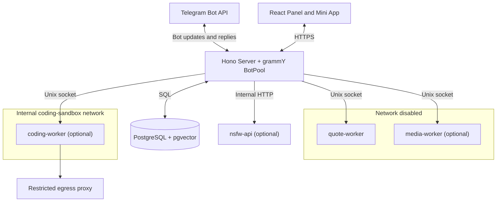

Hanori 的生产 Compose 部署以 Hono `app` 为入口。它提供 API、React 管理面板、Telegram Mini App 和静态文档，并在同一进程内通过 BotPool 运行 grammY Bot。Bot 通过 Telegram Bot API 接收更新并发送消息。

<a href="/docs/architecture.svg">打开原图（SVG）</a>

## 服务端与数据

- **React 管理面板与 Mini App**：两者都经 HTTPS 调用 Hono API。面板使用 Better Auth 登录。Mini App 在 Telegram WebView 内提交签名的 `initData`，服务端验证后建立独立会话并检查访问权限。
- **PostgreSQL + pgvector**：Hono 应用读写 Bot 配置、对话等持久化数据，启动时执行 Drizzle 迁移。pgvector 存储和查询向量。生产 Compose 中数据库仅供内部服务访问。

## 后台服务的隔离边界

- **`quote-worker`**：默认启用，为语录生成图片。Hono 通过共享卷上的 Unix socket 请求渲染。容器禁用网络。
- **`media-worker`**：由 `media` profile 启用。它通过带鉴权的 Unix socket 接收音频转换任务，经共享任务目录传递文件。容器禁用网络，由应用负责访问外部服务。
- **`coding-worker`**：由 `coding` profile 启用。Hono 通过带鉴权的 Unix socket 下发 Pi 任务，经共享任务目录交换文件。worker 仅连接内部 `coding-sandbox` 网络，外部访问经受限出口代理。数据库和 GitHub 凭据留在服务端。
- **`nsfw-api`**：由 `nsfw` profile 启用。Hono 通过 Compose 默认网络调用 HTTP 分类接口。服务无需发布公网端口。

图中的连接方式对应仓库提供的生产 Compose 配置。启用可选服务或排查连接问题时，参见[自托管排障 FAQ](/docs/self-hosting/troubleshooting)。

Mermaid 源码

更新图表时，用下方源码重新生成静态 SVG（Mermaid CLI，`neutral` 主题，`htmlLabels: false`，白色背景）。

