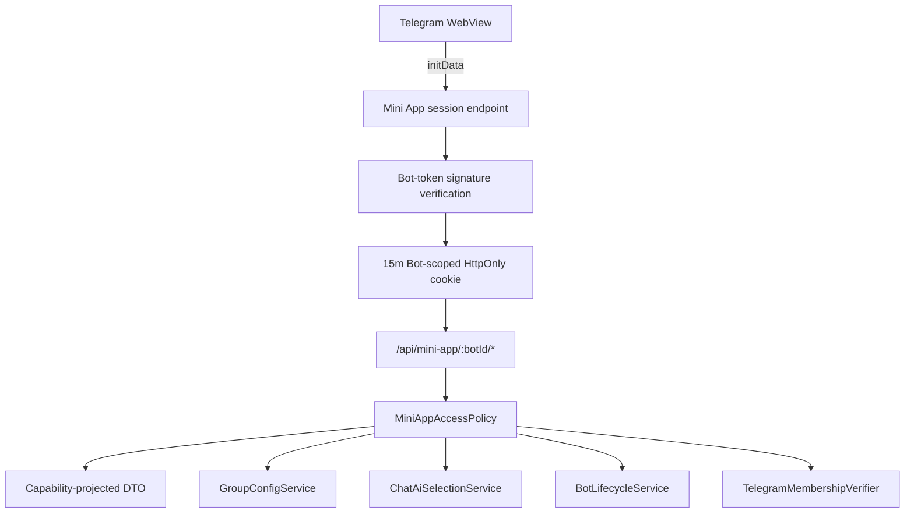

# feat(telegram): 增加 Mini App 管理面板、分层权限与群级模型控制

## 背景

当前 Bot 的管理能力分散在桌面 Web Panel 和 Telegram 命令中。移动端管理员需要手工输入 Telegram ID，群配置依赖大块 AI JSON 更新，Provider/模型命令的持久化与运行态也可能不一致。

目标是在每个 Telegram Bot 内提供一个 Telegram-native Mini App：管理员可以管理当前 Bot、白名单群和常用 AI 配置；显式白名单用户可以操作授权群的低风险配置；授权群的当前成员可以读取安全投影；其他用户仍能查看帮助与项目背景。

这不是把 Better Auth workspace 后台直接暴露给 Telegram，也不是另起一套业务系统。Mini App 必须使用独立的 Bot-scoped session、capability policy 和窄 API，并复用现有 application/domain services。

## 用户故事

- 作为 Bot 管理员，我可以从 Telegram 私聊菜单进入当前 Bot 的管理面板，无需再次登录。
- 作为 Bot 管理员，我可以看到 Bot 当前仍加入的全部群，并管理访问名单、常用全局 AI 设置和任意群的 Provider/模型。
- 作为 Bot 管理员，我可以可靠启用、停用或重启当前 Bot，并看到 desired/runtime 是否一致。
- 作为白名单操作者，我可以修改所有已授权群的低风险运行配置，但不能管理授权、模型、Prompt、凭据或 Bot 生命周期。
- 作为授权群当前成员，我可以查看该群经过投影的配置，但不能执行写操作。
- 作为其他用户，我仍能看到静态 Help、公开命令、项目背景和隐私说明。

## 已确认的产品语义

### Bot 与入口

- 每个 Bot 打开独立 Mini App；会话绑定单一 Bot，不提供 Bot switcher。
- 入口为 Bot 私聊 Menu Button 和 `/panel`；群内不主动推送入口。
- 添加群使用 `https://t.me/<bot_username>?startgroup&admin=manage_chat+pin_messages`。
- 每 Bot 使用默认关闭的 `miniAppEnabled`，先灰度一个测试 Bot。
- 未授权用户仍可访问不依赖 API/session 的静态 Help。

### 角色与群范围

| 角色     | 身份来源                    | 可见群                       | M1 写能力                                                              |
| -------- | --------------------------- | ---------------------------- | ---------------------------------------------------------------------- |
| Admin    | 当前 Bot 的 `adminChatIds`  | Bot 当前仍加入的全部已观测群 | lifecycle、access、常用全局 AI、群配置、任意群 Provider/模型、展示策略 |
| Operator | 独立 user grant             | 全部 Mini App chat grants    | 群启用、AI 群白名单、触发、对话上下文、Summary 运行配置                |
| Viewer   | chat grant 且仍是当前群成员 | 自己当前所属的 granted chats | 无，仅安全只读投影                                                     |
| None     | 其他用户                    | 无                           | 仅 Help                                                                |

解析优先级是 `admin > operator > viewer > none`。Session 只缓存身份，不冻结授权；每个请求实时解析 grant。Viewer membership 可缓存但 TTL 不超过 60 秒。

### Capability 不变量

新增中心化 `MiniAppAccessPolicy`。路由和 service 校验 capability，不直接判断角色名称：

- `bot.lifecycle.manage`
- `bot.settings.read`
- `bot.settings.write`
- `chat.directory.read`
- `group.config.read`
- `group.config.write`
- `chat.ai-selection.read`
- `chat.ai-selection.write`
- `access.manage`
- `audit.read`

未来可以增加 `credentials.manage`、`data.export`、`data.delete`，但 M1 不授予。Telegram Admin 最终可扩展到当前 Bot 的完整能力，但不等同于 workspace owner；workspace-global MCP、备份、日志清理和创建其他 Bot 仍属于 Better Auth workspace。

现有 AI 群白名单和私聊白名单不得复用为 Mini App grant，避免已有用户被静默提升权限。

## M1 功能范围

### 公共 Help

- 项目背景、GitHub 链接、隐私说明；
- 公开基础命令和独立的管理员能力介绍；
- 中文和英文；
- 不查询当前 Bot 的 enabled capabilities、Provider 数量或部署状态；
- 无 Telegram SDK、无 session、甚至 API 不可用时仍能渲染。

命令事实抽到 shared command catalog，由 Bot 注册、`/help`、`setMyCommands` 和 Mini App Help 共用。

### Groups

- Admin 看到 Bot 当前仍加入的全部已观测 group/supergroup；
- Operator 看到全部 granted chats；
- Viewer 只看到自己仍是成员的 granted chats；
- Bot 离群后目录归档只读，重新加入并验证后恢复；
- Admin 可以在群列表卡片快速选择有效 Provider/模型；
- 详情页显示 dirty state、变更摘要并显式保存；
- Viewer 使用只读值，不渲染 disabled forms。

Operator 可修改：

- 群启用；
- 现有 AI group whitelist；
- trigger rules；
- conversation enable/context limits；
- Summary enabled、schedule/timezone、message window、cooldown。

Operator 不能修改 Prompt、Provider、模型、展示策略或凭据。

### Settings（Admin）

- Bot desired/runtime 状态；
- enable、disable、restart；
- global AI enable；
- 从现有已配置、credential usable 的列表选择全局 Provider/模型；
- 编辑全局 System Prompt。

M1 不创建/编辑 Provider，不修改 Base URL/API Key，不搬入群级 Prompt、behavioral Prompt 或高级 tools。

### Access（Admin）

- chat grants 与 operator grants 分开管理；
- 搜索只使用 Telegram ID、username、display name 的安全 profile projection，不搜索人物 notes/traits/interests；
- 未观察用户可按精确 Telegram user ID 添加，显示资料未验证；
- grant 保存 creator、时间和可选 note；
- 最近 90 天活动支持按 actor/action/resource 筛选。

### Provider/模型展示

- 默认向所有有权查看该群面板的人展示有效 Provider 展示名和模型展示名/ID；
- Bot 有全局 show/hide 默认，群有 `inherit/show/hide` 覆盖；
- 只有 Admin 可修改；
- 隐藏时 viewer/operator DTO 完全省略字段；
- 不返回内部 Provider ID、Base URL、API Key 状态、模型探测详情或历史配置；
- 展示策略变更写轻量 audit。

## 架构



### 前端边界

保留一个 Vite build 和一个 BrowserRouter，但拆成两个 lazy surface：

- `/mini-app/:botId/help`：公共静态 Help；
- `/mini-app/:botId/*`：MiniAppApp；
- `/*`：现有 Refine/Better Auth AdminPanelApp。

Mini App 不实例化 Refine auth/data/layout。独立 Telegram adapter 负责 initData、theme、viewport、safe area、ready/expand/back/close 和 StrictMode-safe event cleanup。生产环境禁止 mock；DEV mock 必须由 build-time DEV guard 隔离。

Admin 导航为 Groups / Settings / Access / Help；Operator/Viewer 为 Groups / Help。视觉采用 Telegram adaptive light/dark 语义色、safe-area 和 mobile-first bottom navigation，不照抄某个固定深色截图。

### API 与 Session

- 路径统一为 `/api/mini-app/:botId/*`；
- URL botId 只是 selector；session 内 Bot ID 必须与路径一致；
- Cookie Path 限定当前 Bot API 路径；
- 默认 `HttpOnly + Secure + SameSite=Lax`；只有实机证明需要时才使用 `SameSite=None; Secure`；
- session TTL 15 分钟；
- 验证 initData hash、`auth_date`、未来时间、重复字段和 safe integer；
- 原始 initData 验证后丢弃，不进入日志或浏览器存储；
- mutation 校验 Origin、CSRF、Bot scope、实时 capability 和 revision；
- stale write 返回 `409` 和最新值；
- session endpoint 与重要写入使用单实例基础限流。

Mini App 不直接 mount 现有宽 `/api/bots/*`。可以复用底层 services 和 types，但必须经过 deny-by-default、Bot-scoped facade。

## 数据模型与不可逆决策

### 群目录与 Bot 公开身份

新增 `telegram_chats`，以 `(bot_id, chat_id)` 标识群，保存 group/supergroup 类型、title/username、nullable authoritative Bot membership、observation timestamps、left state 和 migrated target。

新增 `telegram_bot_profiles` 保存 `getMe` 的 Bot user ID、username、display name 和 observed timestamp，用于 UI/deep link，不作为授权主键。

群目录由独立 observation middleware 从普通 updates、`my_chat_member` 和 migration events 幂等更新。现有 `groupOverrides` 只允许回填未验证候选，不自动产生 grant。

### Grants

使用两张显式表，不使用 polymorphic subject：

- `mini_app_chat_grants`；
- `mini_app_operator_grants`。

两表均以 Bot scope 建唯一约束，保存 creator、note 和 timestamps。Viewer 不持久化 membership row，按需通过 Bot API 动态校验。

### 群级 AI selection

把现有 `chat_provider_overrides` 与 `chat_model_overrides` 迁为单一 `chat_ai_selections`：

```text
(bot_id, chat_id) unique
provider_id not null
model_id nullable
revision
updated_by
updated_at
```

- 无 row：继承 global pair；
- 有 row、model null：使用该 Provider default model；
- 非空 model 必须属于该 Provider 已配置/发现的模型列表；
- Provider 与模型必须在同一事务中校验和保存；
- 旧 model-only row 绑定到迁移时的 effective provider，并生成迁移报告。

Provider/模型展示策略不进入 selection 表：Bot 默认保存在 AI 配置，群 `inherit/show/hide` 保存在现有 groupOverrides，经统一 GroupConfigService 更新。

### Telegram ID

继续使用 JS number 和 PostgreSQL bigint(number mode)，所有边界必须校验 safe integer；user ID 为正，group/supergroup chat ID 为负。

### 群迁移

建立集中 `ChatIdentityMigrationService`。basic group 升级为 supergroup 时，事务迁移 chat grant、group config、Summary config、AI selection 等 M1 chat-scoped 数据；目标已有配置时 target wins，并保存 old ID lineage 与 conflict audit。聊天历史不迁移。

## Application services

### GroupConfigService

- `bots.aiConfig.groupOverrides` M1 继续使用 JSON；
- 所有入口仅执行字段级 PATCH；
- 单实例使用按 Bot 锁、latest-value read/merge/write；
- DB 是 source of truth；
- commit 后通过 narrow runtime controller 热应用，不 restart 整个 Bot；
- runtime 应用失败返回 `persisted:true, applied:false`；
- M1 不实现后台重试队列，允许手动 retry，并在下次 Bot start 从 DB 恢复。

### ChatAiSelectionService

作为 Telegram `/provider`、`/model`、现有 Panel 与 Mini App 的唯一写入口：

- 列出 selectable Provider/model public metadata；
- 解析 desired/effective pair 与 source；
- 原子 set/reset global 和 chat selection；
- 先 await DB commit，再 publish immutable runtime snapshot；
- persistence failure 不修改 runtime，不返回成功；
- runtime publish failure 明确返回 pending apply；
- Provider 删除时 reset 受影响 chat selection；模型删除时回退 Provider default；二者均 audit。

移除 `/model <任意字符串>` 和 `modelCommandAccess=all`。群级 Provider/模型只能由当前 Bot Admin 通过统一 `chat.ai-selection.write` capability 修改。

### BotLifecycleService

`bots.isActive` 是 durable desired state：

- enable：先持久化 true，再启动；启动失败保留 desired=true 并返回 unreconciled；
- disable：先持久化 false，再停止；服务重启后不得自动复活；
- restart：只允许 desired=true，保持 desired state；
- 所有 transition 使用现有 per-Bot serialization；
- 返回 `{desiredActive, runtimeStatus, reconciled}`；
- start 无确认，stop/restart 二次确认但不填写原因；
- lifecycle 写入 audit。

Stop 停止新 updates，取消活跃 AI 生成和未完成内部任务；已发生的外部 tool side effect 不回滚。已保存配置、历史和其他 Bot 不受影响。

Active timer 在停机期间保留；start/restart 恢复，过期提醒补发一次并标记 delayed。实现必须修复现有普通 stop/restart 遗失 timer handle，并定义 Summary/RSS 等 Bot-scoped job 的一致停止语义。

### TelegramMembershipVerifier

由 running BotManager 实现，只暴露窄 membership/status 查询，不暴露 token 或原始 API client。Viewer membership、chat grant 创建和目录 refresh 共用该 seam。

Bot 停机/API 不可用时 Viewer fail closed；Admin/Operator 仍能读写已有配置。Chat grant 创建必须在线验证 Bot 为群 administrator。有效 viewer status 为 creator/administrator/member/restricted+is_member；left/kicked/restricted false 拒绝。

## 隐私、安全与审计

Bot 成为群管理员后，即使 Privacy Mode 开启也会收到全部群消息。发布前必须：

- 通用 Bot 日志永不持久化群消息正文，只记录结构化 identifiers、event type 和 result；
- chat grant 不得自动开启 AI conversation/history；
- 添加群流程明确披露管理员 Bot 的消息可见性；
- 只有明确开启的业务能力可以在专用存储处理消息内容。

Grant、group config、AI selection、展示策略和 lifecycle 的 mutation 与 audit 必须处于同一 DB transaction；audit 失败则 mutation 失败。Audit 不保存 token、key、Cookie、原始 initData 或群消息正文。读取不审计；登录失败只记录类别和聚合计数。

生产发布还要求：

- `/api/*` unmatched route 返回 JSON 404，不进入 SPA fallback；
- hashed assets immutable cache、HTML no-cache；
- Telegram WebView 兼容 CSP/security headers；
- HTTPS preflight；
- surface-level error boundary 和外部错误脱敏。

## 顺手完成的高收益重构

M1 包含：

1. 共享 command catalog；
2. 唯一 `GroupConfigService.patch`；
3. database 复用 shared `AiConfigStored`，移除重复手写类型；
4. 单表 `chat_ai_selections` 与统一 `ChatAiSelectionService`；
5. `BotLifecycleService`；
6. Summary update/delete 的 Bot-scoped atomic 修复和手动 cooldown 条件占用；
7. 群消息正文日志移除。

完整 Provider CRUD、模型目录正规化、AI JSON 全面正规化、多实例 CAS/共享缓存、分布式限流和安全事件面板后移。

## Goals（暂不创建子 Issue）

每个 Goal 都应形成可独立验证的纵向切片。实际开工时再按这些边界创建子 Issue。

### G0：隐私与共享事实基线

Blocked by：None。

- [ ] 通用日志不持久化群消息正文，并有回归测试。
- [ ] command catalog 成为注册、`/help`、`setMyCommands` 和静态 Help 的单一事实源。
- [ ] database 复用 shared `AiConfigStored`。
- [ ] Summary update/delete 是 Bot-scoped atomic，manual cooldown 使用条件占用。

### G1：Telegram 身份、群目录与权限内核

Blocked by：G0。

- [ ] initData/session 可拒绝篡改、过期、未来时间、错 Bot、重复字段和 unsafe ID。
- [ ] 建立 Bot profile、chat catalog、两类 grant、audit 与 capability policy。
- [ ] membership verifier fail closed，grant removal 对 mutation 立即生效。
- [ ] chat migration 能事务迁移 M1 chat-scoped 数据并记录冲突。

### G2：公共 Help 与 Mini App shell

Blocked by：G0。

- [ ] 无 session/API 时 Help 仍可渲染，不泄漏当前 Bot capability。
- [ ] Mini App 与 Admin Panel 是两个 lazy surface，互不实例化对方 auth/layout。
- [ ] zh-CN/en、Telegram light/dark、safe-area、viewport 和 BackButton 正确。

### G3：访问名单纵向闭环

Blocked by：G1、G2。

- [ ] Admin 可搜索安全 profile projection、按精确 ID 添加 operator、撤销 grant。
- [ ] Admin 可用 startgroup deep link 添加群，返回后验证 Bot admin status。
- [ ] Operator/Viewer/None 得到正确导航、DTO 和 403。
- [ ] Access 页面展示近 90 天活动。

### G4：群配置纵向闭环

Blocked by：G1、G2、G3。

- [ ] Groups list/detail 按角色投影正确。
- [ ] Operator 只能修改 granted chat 的允许字段。
- [ ] field PATCH 不覆盖其他配置，stale revision 返回 409。
- [ ] DB commit 后热应用；失败明确显示 saved/pending apply。

### G5：全局与群级 Provider/模型

Blocked by：G1、G4。

- [ ] 迁移为单表 selection，旧数据迁移报告可检查。
- [ ] Provider/model pair 原子校验，不允许跨 Provider 非法模型。
- [ ] Admin 可修改全局 pair 和任意当前 Bot 群的 pair；其他角色不能写。
- [ ] Telegram commands、现有 Panel 和 Mini App 共用 awaited service。
- [ ] 展示策略默认公开，群可覆盖，隐藏字段由 API 省略。

### G6：Bot lifecycle 与常用 Settings

Blocked by：G1、G2。

- [ ] desired/runtime 状态可区分并可 reconcile。
- [ ] enable/disable 在 server restart 后保持用户选择。
- [ ] restart/stop 不遗失 active timer，overdue timer 只补发一次并标记 delayed。
- [ ] Stop 的 AI、Summary、RSS 等 Bot-scoped job 行为有测试。
- [ ] Admin 可修改 global AI enable/System Prompt，并看到 pending-apply 状态。

### G7：生产硬化与单 Bot 灰度

Blocked by：G3、G4、G5、G6。

- [ ] 完成 JSON API fallback、Cookie/CSRF/Origin、基础限流、CSP/cache/HTTPS 和错误脱敏。
- [ ] migration SQL、forward migration、rollback 和旧数据报告均验证。
- [ ] 默认关闭，只为测试 Bot 开启并配置 Menu Button。
- [ ] Telegram iOS、Android、Desktop、Web 覆盖登录、Cookie、主题、返回、权限撤销和失败态。

## Epic 验收标准

- [ ] Bot A 的 initData、Cookie、grant 或 URL botId 无法访问 Bot B。
- [ ] 未授权用户总能访问 Help，但拿不到当前 Bot 的运行能力或配置。
- [ ] Admin/Operator/Viewer/None 的可见字段和 mutation 符合权限矩阵。
- [ ] Viewer 失去群成员身份后最迟 60 秒失效；grant 撤销立即阻止写入。
- [ ] Bot/API 离线时 Viewer fail closed，Admin/Operator 仍可保存已有配置。
- [ ] Provider/model 永不形成非法 pair；DB 失败不得伪装成功。
- [ ] Stop 后服务重启不复活 disabled Bot；restart 不丢 timer。
- [ ] group → supergroup 后 grant/config/summary/selection 迁移到新 chat ID。
- [ ] Mini App 响应、日志和浏览器状态均不包含 token、key、原始 initData 或群消息正文。
- [ ] 现有 Better Auth Panel 登录、路由和权限不受影响。
- [ ] 自动化测试与 Telegram 四端实机验收通过后才扩大 feature flag。

## Rollout 与回滚

1. 先部署 migration、隐私修复和 application services，不开放 route/menu。
2. 部署 Mini App routes/surface，所有 Bot 的 `miniAppEnabled=false`。
3. 仅为测试 Bot 开启，验证 admin/operator/viewer/none、错 Bot 签名和权限撤销。
4. 添加一个测试群和 operator，完成四类客户端验收。
5. 配置测试 Bot Menu Button，再决定正式 Bot rollout。

回滚先关闭 feature flag 和 Menu Button，再停用 Mini App routes。新增目录、grant、selection、audit 表可以安全保留；确认导出后才允许 drop。现有 AI whitelist 不迁移，因此回滚不改变 Bot 对话授权。

## Non-goals

- M1 不管理 Provider credentials、Bot token、GitHub、MCP、backup、files 或 data import/export/delete。
- M1 不支持 channel/private-chat grants。
- M1 不授予 Telegram Admin workspace-global owner 权限。
- M1 不实现完整 Provider CRUD、任意模型 ID、多实例共享状态或复杂安全事件后台。
- M1 不创建本 Epic 的子 Issue；实施开始时再按 Goals 拆分。

## 官方参考

- [Telegram Mini Apps](https://core.telegram.org/bots/webapps)
- [Telegram Bot API](https://core.telegram.org/bots/api)
- [Telegram Deep Links](https://core.telegram.org/api/links)
- [Telegram Suggested Admin Rights](https://core.telegram.org/api/rights)
